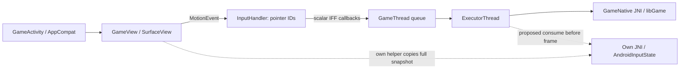

# A2: Android launch и input entrypoint (static)

**Конкретный seam — Java `GameView.onTouchEvent(MotionEvent)` перед `InputHandler`, затем собственный JNI bridge к уже написанному `AndroidInputState`.** Исследуемое приложение использует AppCompatActivity + SurfaceView + собственный GameThread; native `AInputQueue`/NativeActivity здесь не установлен как путь доставки событий. Готовый `AndroidInputAdapter` остаётся полезным для отдельного NativeActivity host, но не подключается к этому APK сам по себе.

Binding: локальный APK SHA256 `348750d29d2e463768a2c806dc01c331f2b88fce1646fba8e7485e6c3ff6ff50` из ранее проверенного inventory; package `com.rockstargames.gtasa`, versionCode `4234641`, versionName `2.11.311`, minSdk28/target36. На этом проходе весь APK повторно не хэшировался. Три DEX проверены потоково (CRC/SHA256, без extraction); их identity в `verification/static-entrypoints.json`. Подпись/происхождение модифицированного пакета остаются непроверенными. Бинарники и декомпилированные тела в Git не включены.

## Наблюдаемые факты

Все классы и descriptors ниже взяты из реального DEX через существующий official Android SDK `apkanalyzer dex code`, а не из PC MTA или чужого mobile fork. Номера строк относятся к raw captures в ignored lab `D:/projects/astana/work/mta-mobile-lab/android-game-apk-348750d2/entrypoints/`; их hashes/команды/exit codes закреплены в verification JSON, тела остаются в lab.

| Факт | Class/method и raw capture |
|---|---|
| Launch Activity | Manifest объявляет `com.rockstargames.gtasa.GameActivity` (manifest:140). Он наследует `GameActivityBase` (gameactivity:2), тот — `androidx.appcompat.app.AppCompatActivity` (gameactivitybase:2). |
| Загрузка game library | `com.rockstargames.oswrapper.GameNative.<clinit>()V` вызывает `System.loadLibrary("Game")` (gamenative:119–134). Это native game entry, не загрузка нашего кода и не proof успешного JNI_OnLoad. |
| View и surface | `GameView` наследует `android.view.SurfaceView` и реализует `SurfaceHolder.Callback2` (gameview:2/6). SurfaceCreated/Changed/Destroyed передаются в GameThread (gameview:655–778). |
| Touch | `GameView.onTouchEvent(MotionEvent)` передаёт событие `InputHandler.onTouchEvent` (gameview:517/526). Handler читает actionIndex→pointerId и actionMasked; MOVE обходит все pointer indices и извлекает ID+X/Y каждого (inputhandler:1229–1396). Внутренний SparseArray индексируется pointer ID. |
| Up/cancel | Handler отправляет end для сохранённого touch и удаляет его; CANCEL обходит/очищает сохранённые touches. Это наблюдение реализации APK; наш reducer не обязан копировать хранение старых координат на up. |
| JNI touch signature | `GameNative.implOnTouchStart/Move/End(IFF)V`: pointer ID int, X/Y float (gamenative:318/323/328). Методы объявлены static native. |
| Thread ownership | GameThread.onTouch* захватывают scalar ID/X/Y в callbacks и вызывают queueEvent; ConcurrentLinkedQueue хранит Runnable (gamethread:1215/2463–2497). ExecutorThread poll/run исполняет очередь (executor:107–211). Java MotionEvent в этой цепочке не сохраняется как событие для последующего native чтения. |
| Frame entry | ExecutorThread после очереди вызывает `GameNative.implOnDrawFrame(F)V` при `GameView.hasFocus && implIsInitialized`. F вычисляется как elapsedRealtime delta /1000 (executor:158–190). Это кандидат для consume собственного input frame, не proof native world/physics tick ordering. |
| Lifecycle | Activity.onPause/onResume передают переход GameView; view делегирует GameThread и view handlers (gameactivitybase:820/840; gameview:433/475). Focus меняет pause/resume view (gameview:552–586). InputHandler.processing отключается/включается на pause/resume; полного native reset этим статическим наблюдением не доказано. |
| Native bootstrap dependencies | `implOnInitialSetup(DeviceInfo,AssetManager,String[],String[])`, `implOnActivityCreated(GamePlatformServices,Z)`, `implOnSurfaceChanged(Surface,II)` и прочие static native declarations — реальные descriptors (gamenative:153/223/303). GameThread читает packNames/packPaths из Intent, default pack name `data_main` (gamethread:1865+). Activity также настраивает Nv helpers и Rockstar services. Один loadLibrary эти контракты не заменяет. |

## Реализация собственного bootstrap/input bridge

Следующий source slice — **работающий самостоятельный JNI bridge**, а не ещё один unavailable contract:

- Own Java helper в собственном namespace получает MotionEvent на `GameView.onTouchEvent` seam, копирует full pointer snapshot (`getPointerId(i)`, `getX/Y(i)`, actionMasked, changed ID) синхронно. Не сохранять MotionEvent после callback: объект может быть recycled. В observer slice не заменять результат stock handler и не отправлять второй набор touches в game JNI.
- Own JNI library принимает bounded arrays (max32), проверяет lengths/IDs/finite coordinates/action, передаёт snapshot в тот же portable reducer. UI feed и GameThread consume сериализуются коротким mutex; никаких engine calls или Java callbacks под ним. State хранит held controls и bounded accumulated delta, без растущей очереди.
- Pause/focus lost/IME/back/surface resize вызывают уже предусмотренный reset/flags/layout API. Surface dimensions + safe inset rectangle передаются в координатах того же View; IME и Insets требуют отдельной host wiring, из факта наличия game JNI они не следуют.
- ExecutorThread candidate seam перед `implOnDrawFrame` потребляет own frame ровно один раз; результат пока только собственные semantic values/diagnostics. Никаких CPad casts, CVehicle/CMatrix layouts, engine writes или Lua ACK из этого bridge.
- Own library загружается явным `System.loadLibrary` собственного helper. Собственная bootstrap Activity при отдельном стенде может использовать SurfaceView; для запуска самой игры ещё нужны реальные asset/platform/surface/service contracts выше. Не подменять их успешными заглушками.

Installed NDK28.2 `android/input.h:1490` объявляет `AMotionEvent_fromJava(JNIEnv*,jobject)` с `__INTRODUCED_IN(31)`. Для текущего minSdk28 Java→bounded scalar arrays→JNI применим без этой новой функции. Нельзя reinterpret_cast Java MotionEvent в `AInputEvent*`. Перенос всего APK на NativeActivity ради использования одного готового adapter потребовал бы другой launch/surface/service wiring; сейчас это не минимальный путь.

## Что доказано и что ещё нет

Факт: статическая class/call chain, JNI descriptors, scalar pointer-ID delivery и loadLibrary target. Инференс: observer bridge удобно присоединить перед InputHandler, consumer — перед native frame callback. Неизвестно: actual load/initialization, complete engine ABI/layouts, touch→camera/drive mapping, timing physics/render, native reset on background, IME/insets integration, resources/licenses/services readiness и runtime ARM translation. APK не устанавливался, не запускался, game functions не вызывались. Это A2 static entry map; U1 и A3/shared-world этим не пройдены.

REA skill применён; REA Android provider ранее unavailable из-за отсутствующего JADX jar. Не устанавливался и повторно не настраивался. Fallback — существующий SDK CLI (`apkanalyzer-classpath.jar` / `ApkAnalyzerCli`, эквивалент установленного bat wrapper), Java21, `-Xmx256m`, process-only environment, fresh RAM>=1536MiB перед каждым CLI. Полная APK extraction/rehash не выполнялась. Raw smali/XML только в ignored lab. Два диагностических вызова закончились exit1: unsupported `--help` и отсутствующий предполагаемый class `oswrapper.GameActivity`; их metadata также сохранены, факты из них не выводятся.

Перед будущим APK pack/install root review должен увидеть точный набор собственных Java/native файлов, original APK/DEX identities, output helper DEX и native library hashes, diff list изменяемых ZIP entries, новый package/signature fingerprint и план восстановления. Декомпилированные bodies не переносятся в Git. Current VM003 не используется для установки этого APK; перед GUI запуском предупредить пользователя. Нового пользовательского permission gate этот документ не добавляет.
